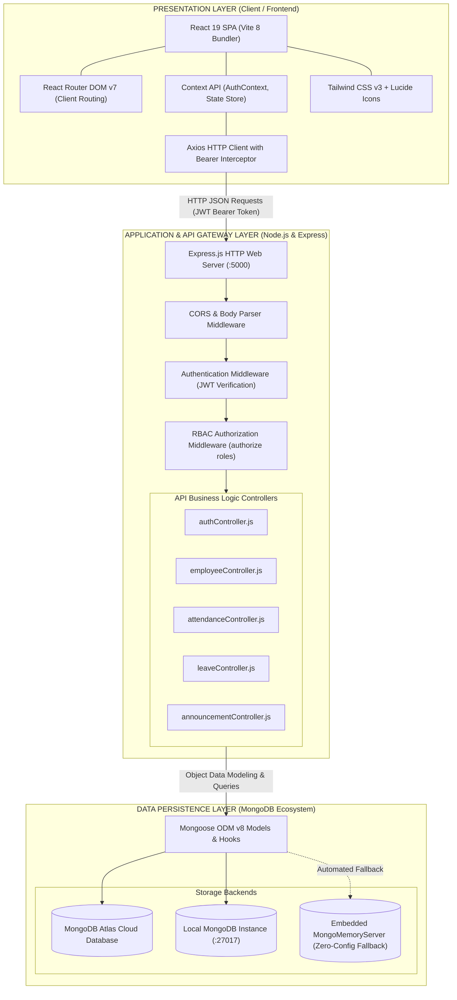
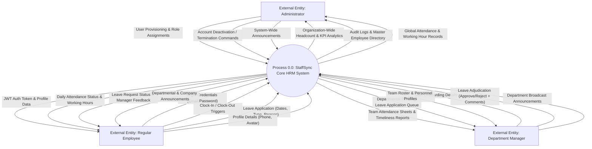
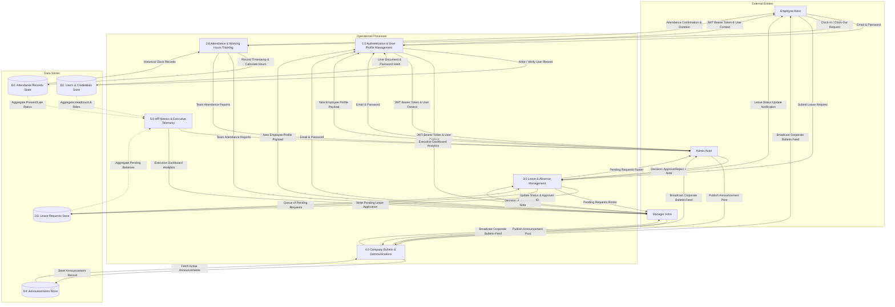
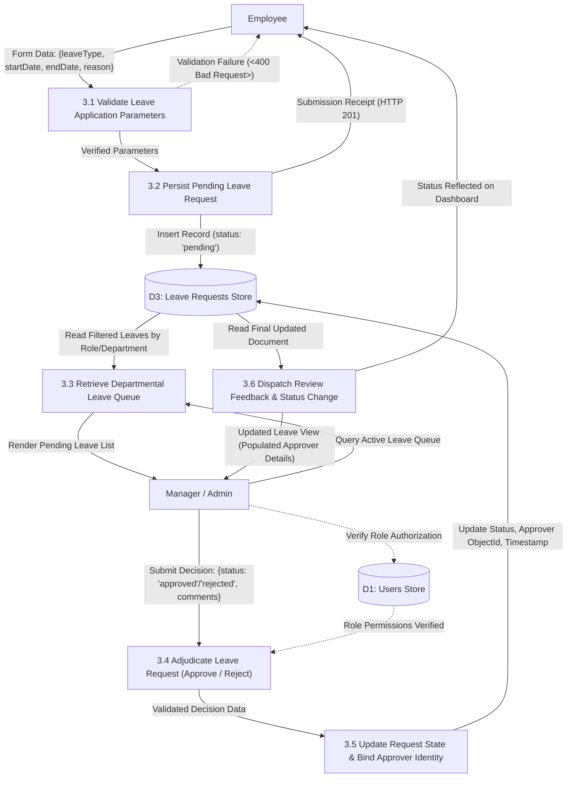
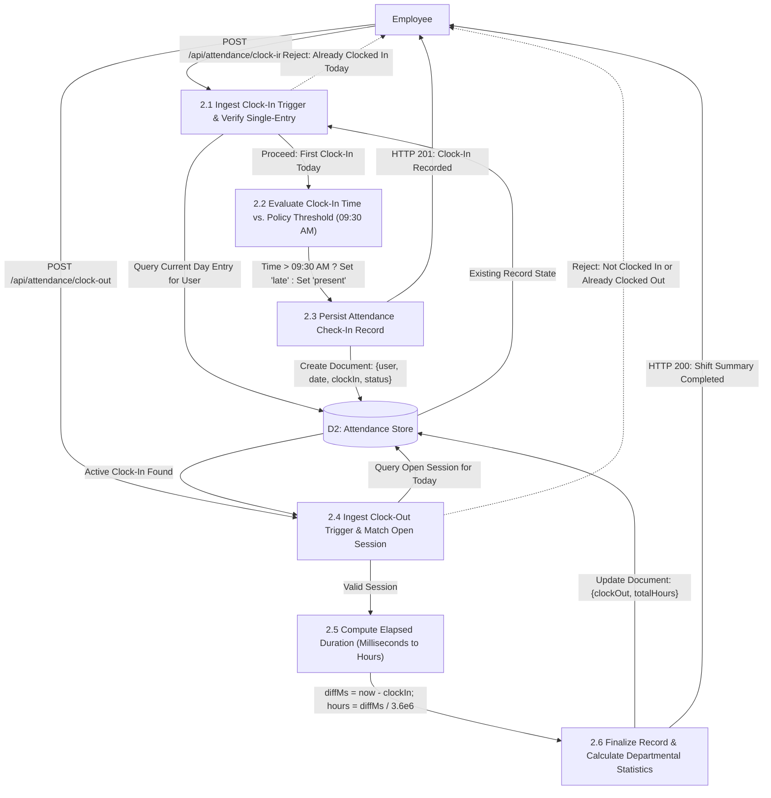
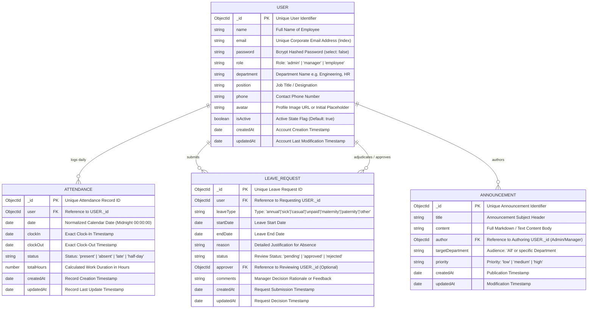
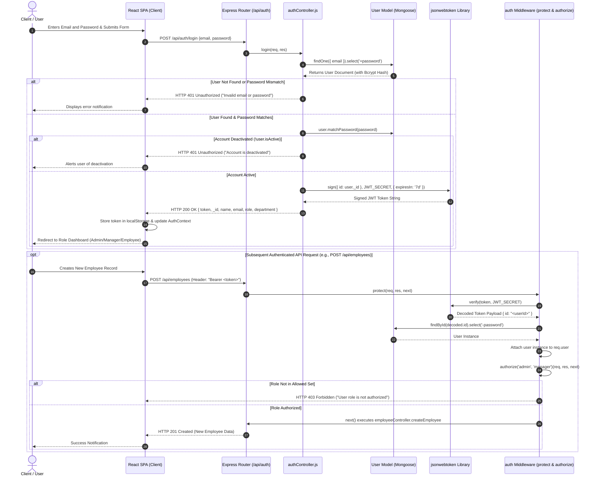
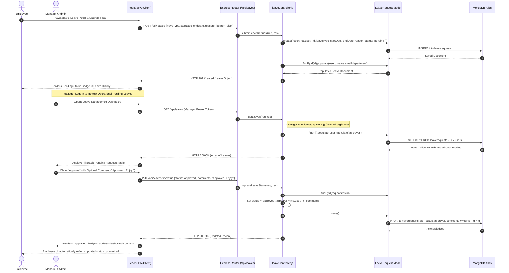
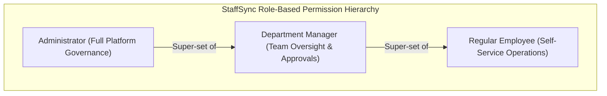

# StaffSync — Enterprise HR & Workforce Management System

[](https://nodejs.org/)
[](https://react.dev/)
[](https://expressjs.com/)
[](https://www.mongodb.com/)
[](https://tailwindcss.com/)
[](LICENSE)

StaffSync is an enterprise-grade Human Resource Management System (HRMS) engineered on the modern MERN architecture (MongoDB, Express.js, React 19, Node.js). Designed for scalable organizational operations, StaffSync delivers end-to-end personnel governance including multi-tiered Role-Based Access Control (RBAC), biometric-style attendance logging with automated punctuality calculation, multi-stage leave request lifecycle adjudication, inter-departmental bulletins, and executive dashboard telemetry.

---

## Table of Contents

- [1. Executive System Overview](#1-executive-system-overview)
- [2. System Architecture](#2-system-architecture)
  - [2.1 High-Level Multi-Tier Architecture Diagram](#21-high-level-multi-tier-architecture-diagram)
  - [2.2 Architectural Layers Specification](#22-architectural-layers-specification)
- [3. Data Flow Diagrams (DFD)](#3-data-flow-diagrams-dfd)
  - [3.1 DFD Level 0 — Context Diagram](#31-dfd-level-0--context-diagram)
  - [3.2 DFD Level 1 — Core Operational Processes](#32-dfd-level-1--core-operational-processes)
  - [3.3 DFD Level 2 — Detailed Sub-Process Decompositions](#33-dfd-level-2--detailed-sub-process-decompositions)
    - [3.3.1 DFD Level 2.1: Leave Request Lifecycle](#331-dfd-level-21-leave-request-lifecycle)
    - [3.3.2 DFD Level 2.2: Attendance & Timeliness Computation](#332-dfd-level-22-attendance--timeliness-computation)
- [4. Entity-Relationship Diagram (ERD)](#4-entity-relationship-diagram-erd)
  - [4.1 Visual Schema Relationships](#41-visual-schema-relationships)
  - [4.2 Data Dictionary & Schema Definitions](#42-data-dictionary--schema-definitions)
- [5. System Sequence Diagrams](#5-system-sequence-diagrams)
  - [5.1 User Authentication & RBAC Verification Flow](#51-user-authentication--rbac-verification-flow)
  - [5.2 Leave Application, Review & Notification Flow](#52-leave-application-review--notification-flow)
- [6. Software Requirements Specification (SRS)](#6-software-requirements-specification-srs)
  - [6.1 Introduction (Purpose, Scope, Definitions)](#61-introduction)
  - [6.2 Overall Description (Product Perspective, User Classes, Operating Environment)](#62-overall-description)
  - [6.3 Functional Requirements (FR-01 through FR-06)](#63-functional-requirements)
  - [6.4 Non-Functional Requirements (Performance, Security, Reliability)](#64-non-functional-requirements)
  - [6.5 External Interface Requirements & REST API Specification](#65-external-interface-requirements--rest-api-specification)
- [7. Project Setup & Quickstart Guide](#7-project-setup--quickstart-guide)
  - [7.1 Prerequisites](#71-prerequisites)
  - [7.2 Environment Variable Configuration](#72-environment-variable-configuration)
  - [7.3 Local Installation & Execution](#73-local-installation--execution)
  - [7.4 Pre-seeded Demo Accounts](#74-pre-seeded-demo-accounts)
  - [7.5 Automated Test Suite Execution](#75-automated-test-suite-execution)
- [8. Security & Zero-Configuration Architecture](#8-security--zero-configuration-architecture)
- [9. License & Contribution](#9-license--contribution)

---

## 1. Executive System Overview

Modern workforce ecosystems require robust, transparent, and auditable personnel administration. StaffSync centralizes key HR competencies into a unified single-page application (SPA):

- **Granular Role-Based Access Control (RBAC)**: Segregated operational views and functional permissions tailored specifically for **Admins**, **Managers**, and **Employees**.
- **Real-Time Attendance Engine**: Immediate check-in/check-out clocking, automatic punctuality status calculation (`present` vs. `late` computed dynamically against morning work schedule policies), and cumulative shift duration tracking.
- **Workflow-Driven Leave Management**: Self-service time-off applications with departmental routing, manager adjudication with comments, status audit logs, and calendar synchronization.
- **Corporate Bulletins & Announcements**: Department-scoped and priority-flagged notification boards ensuring real-time alignment across distributed teams.
- **Analytics & People Telemetry**: Aggregated metrics on headcount, departmental distributions, on-duty ratios, and pending administrative queues.
- **Zero-Friction In-Memory Fallback**: Native resilience mechanism providing automatic deployment of an embedded MongoDB engine if external clusters are unreachable, guaranteeing seamless local evaluation.

---

## 2. System Architecture

StaffSync implements a decoupled, event-resilient 3-tier client-server architecture adhering to RESTful API conventions and stateless authentication.

### 2.1 High-Level Multi-Tier Architecture Diagram



### 2.2 Architectural Layers Specification

1. **Presentation Layer (Frontend - React 19 / Vite 8)**:
   - Built as an ultra-responsive Single Page Application (SPA) compiled by Vite.
   - Leverages **Tailwind CSS** for responsive component design and **Lucide React** for accessible icon telemetry.
   - Global session state is managed via React `AuthContext`, handling token persistence in `localStorage`, automated profile hydration, and declarative route guarding.
   - Axios client configured with request interceptors to automatically dispatch `Authorization: Bearer <token>` headers on all API calls.

2. **Application & API Gateway Layer (Backend - Express.js / Node.js v26)**:
   - Hosted on Node.js using Express.js as the application framework.
   - Implements a stateless security perimeter via `protect` (verifying cryptographically signed RS256/HS256 JWT tokens) and `authorize('admin', 'manager')` (role whitelist enforcement).
   - Structured according to the Model-View-Controller (MVC) architectural pattern, separating routing, business validation, and database operations.

3. **Data Persistence Layer (MongoDB / Mongoose ODM)**:
   - Schema enforcement, field typing, pre-save hooks (e.g. automatic Bcrypt salt/hashing on passwords), and virtual properties executed through Mongoose v8.
   - Implements **smart fallback redundancy**: if the primary MongoDB connection string is unreachable or absent, the server dynamically provisions an in-memory replica (`mongodb-memory-server`) and triggers auto-seeding.

---

## 3. Data Flow Diagrams (DFD)

### 3.1 DFD Level 0 — Context Diagram

The Context-Level Data Flow Diagram establishes the global boundary of the StaffSync system, identifying the primary human actors and the high-level inputs/outputs exchanged with the core platform.



---

### 3.2 DFD Level 1 — Core Operational Processes

Decomposition of the StaffSync system into its five fundamental transactional processes, mapping the movement of information to the respective data stores.



---

### 3.3 DFD Level 2 — Detailed Sub-Process Decompositions

#### 3.3.1 DFD Level 2.1: Leave Request Lifecycle

Detailed decomposition of **Process 3.0 (Leave & Absence Management)** illustrating submission, validation, review queueing, manager decision-making, and audit logging.



#### 3.3.2 DFD Level 2.2: Attendance & Timeliness Computation

Detailed decomposition of **Process 2.0 (Attendance & Working Hours Tracking)** illustrating check-in validation, automated punctuality classification, clock-out duration arithmetic, and historical reporting.



---

## 4. Entity-Relationship Diagram (ERD)

### 4.1 Visual Schema Relationships



### 4.2 Data Dictionary & Schema Definitions

| Collection | Field Name | Type | Key / Constraint | Description |
|---|---|---|---|---|
| `users` | `_id` | ObjectId | PK, Auto | Unique MongoDB Identifier |
| `users` | `email` | String | Unique, Indexed, Lowercase | Corporate email used for login identification |
| `users` | `password` | String | Hashed, `select: false` | 10-round salted Bcrypt password hash |
| `users` | `role` | String | Enum: `['admin', 'manager', 'employee']` | Security classification governing access barriers |
| `users` | `department` | String | Default: `'General'` | Functional division of the employee |
| `users` | `position` | String | Virtual: `designation` | Official job designation |
| `users` | `isActive` | Boolean | Default: `true` | Soft-deletion flag controlling system login eligibility |
| `attendances` | `_id` | ObjectId | PK, Auto | Unique Attendance Log ID |
| `attendances` | `user` | ObjectId | FK -> `users._id` | Bound employee identity |
| `attendances` | `date` | Date | Required | Calendar day normalized to midnight |
| `attendances` | `clockIn` | Date | Optional | Recorded timestamp when worker checked in |
| `attendances` | `clockOut` | Date | Optional | Recorded timestamp when worker checked out |
| `attendances` | `status` | String | Enum: `['present', 'late', 'absent', 'half-day']` | Automatic timeliness state based on arrival time |
| `attendances` | `totalHours` | Number | Default: `0.00` | Precision floating point calculated shift duration |
| `leaverequests` | `_id` | ObjectId | PK, Auto | Unique Leave Application ID |
| `leaverequests` | `user` | ObjectId | FK -> `users._id` | Applicant employee identity |
| `leaverequests` | `leaveType` | String | Enum: `['annual', 'sick', 'casual', 'unpaid', ...]` | Category of time-off requested |
| `leaverequests` | `startDate` | Date | Required | Beginning date of absence period |
| `leaverequests` | `endDate` | Date | Required | Terminal date of absence period |
| `leaverequests` | `status` | String | Enum: `['pending', 'approved', 'rejected']` | Adjudication state |
| `leaverequests` | `approver` | ObjectId | FK -> `users._id` (Nullable) | Manager or Admin who finalized the review |
| `announcements` | `_id` | ObjectId | PK, Auto | Unique Bulletin Post ID |
| `announcements` | `author` | ObjectId | FK -> `users._id` | Manager/Admin creator of the notification |
| `announcements` | `priority` | String | Enum: `['low', 'medium', 'high']` | Visual urgency indicator for staff |

---

## 5. System Sequence Diagrams

### 5.1 User Authentication & RBAC Verification Flow

This sequence traces an end-user submitting authentication credentials, validating security tokens, issuing a Signed JSON Web Token, and subsequent access through RBAC middleware barriers.



### 5.2 Leave Application, Review & Notification Flow

Traces the submission of an employee leave request, status synchronization in the database, retrieval by a designated manager, and adjudication with comments.



---

## 6. Software Requirements Specification (SRS)

> **Standard Compliance**: This SRS is structured in strict conformance with **IEEE Standard 830-1998** recommendations for Software Requirements Specifications.

### 6.1 Introduction

#### 6.1.1 Purpose
This document provides the definitive Software Requirements Specification for the **StaffSync Human Resource and Employee Management System**. It defines the functional capabilities, performance standards, architectural constraints, security controls, and integration interfaces for system verification and deployment.

#### 6.1.2 Document Conventions
- **MUST / SHALL**: Denotes mandatory operational requirements.
- **SHOULD**: Denotes recommended best practices.
- **MAY**: Denotes optional configurations.
- Requirement Identifiers are indexed by domain (e.g., `FR-AUTH-01`, `NFR-SEC-01`).

#### 6.1.3 Intended Audience & Reading Suggestions
This document is engineered for Full-Stack Developers, Cloud Solutions Architects, Quality Assurance Engineers, System Administrators, and HR Operations Stakeholders. Developers should focus on [Sections 6.3](#63-functional-requirements) and [6.5](#65-external-interface-requirements--rest-api-specification), while DevOps and Security personnel should review [Section 6.4](#64-non-functional-requirements).

#### 6.1.4 Product Scope
StaffSync is an enterprise Human Resource Management System designed to eliminate paper-based workflows, reduce administrative overhead, enforce punctuality standards, streamline absence approvals, and provide leadership with real-time operational workforce insights.

#### 6.1.5 Definitions, Acronyms, and Abbreviations
- **HRMS / HRM**: Human Resource Management System.
- **RBAC**: Role-Based Access Control.
- **JWT**: JSON Web Token (RFC 7519).
- **ODM**: Object Data Modeling (Mongoose).
- **SPA**: Single Page Application.
- **REST**: Representational State Transfer.
- **Bcrypt**: Adaptive cryptographic key derivation function for password hashing.

---

### 6.2 Overall Description

#### 6.2.1 Product Perspective
StaffSync operates as a self-contained, cloud-ready client-server system. It integrates natively with MongoDB database clusters and provides an extensible RESTful JSON interface capable of integrating with external payroll, ERP, or Active Directory systems.

#### 6.2.2 User Classes & Characteristics



1. **Administrator (`admin`)**:
   - *Technical Persona*: HR Director, Operations Head, IT Admin.
   - *Capabilities*: Complete CRUD privileges across all employee records, role assignments (`admin`, `manager`, `employee`), account activation/deactivation, company-wide announcements, global leave override, and company-wide telemetry.

2. **Department Manager (`manager`)**:
   - *Technical Persona*: Team Lead, Engineering Manager, Department Head.
   - *Capabilities*: Provision new staff members, review all company leave requests, approve/reject absence applications with rationale, post departmental announcements, and review team attendance sheets.

3. **Regular Employee (`employee`)**:
   - *Technical Persona*: Individual Contributor, Staff Member.
   - *Capabilities*: Self-service attendance clock-in/out, submit leave applications, review personal attendance and leave logs, update personal profile data, view company announcements.

#### 6.2.3 Operating Environment
- **Client Platforms**: Modern Evergreen Web Browsers (Chrome 120+, Firefox 120+, Safari 17+, Edge 120+) supporting ECMAScript 2022.
- **Server Runtime**: Node.js v20.0.0 through v26.x running on Linux (Ubuntu 22.04 LTS / Debian 12), macOS Sonoma/Sequoia, or Windows 11 / Server 2022.
- **Database Engine**: MongoDB v6.0 or v8.0 Enterprise / Community Edition, MongoDB Atlas Cloud, or embedded `mongodb-memory-server` v11.3+.

#### 6.2.4 Design & Implementation Constraints
- System must communicate strictly over HTTPS in production.
- Client state is stateless; credentials must never be stored in plain text or cookies without encryption.
- Zero local disk state dependencies; database storage must be completely managed via MongoDB ODM.

---

### 6.3 Functional Requirements

#### Module 1: Authentication & Role-Based Access Control (RBAC)
- **`FR-AUTH-01` (Registration)**: The system shall provide an endpoint to register new user accounts with encrypted passwords (minimum 6 characters, hashed with 10 salt rounds).
- **`FR-AUTH-02` (Login & Token Issuance)**: The system shall authenticate credentials against stored hashes and issue an RFC 7519 compliant JSON Web Token containing user ID with an expiration of 7 days.
- **`FR-AUTH-03` (Deactivated Account Gate)**: The system shall reject login attempts immediately if the account flag `isActive === false`.
- **`FR-AUTH-04` (Route Authorization)**: The system shall restrict administrative routes (`/api/employees` POST/DELETE, `/api/leaves/:id/status`, `/api/announcements` POST) to authenticated tokens containing verified `admin` or `manager` roles.

#### Module 2: Employee Lifecycle & Directory Management
- **`FR-EMP-01` (Employee Directory Retrieval)**: The system shall allow authenticated users to browse the directory with search filters for `name`, `email`, `department`, and `role`.
- **`FR-EMP-02` (Employee Provisioning)**: Admins and Managers shall be authorized to create employee records with default temporary passwords.
- **`FR-EMP-03` (Profile Self-Service)**: Employees shall be permitted to update their own phone numbers and profile avatars.
- **`FR-EMP-04` (Soft Deletion)**: Admins shall have exclusive authority to deactivate employees via `DELETE /api/employees/:id`, which flips `isActive` to `false` without destroying relational foreign keys.

#### Module 3: Attendance Tracking & Automated Timeliness Detection
- **`FR-ATT-01` (Clock-In Enforcement)**: Employees shall be able to clock in once per calendar day. Duplicate clock-ins on the same calendar day shall be rejected with HTTP 400.
- **`FR-ATT-02` (Automated Punctuality Status)**: The clock-in engine shall automatically evaluate the timestamp against the 09:30 AM threshold. If `hours > 9 || (hours === 9 && minutes > 30)`, the status is tagged as `'late'`; otherwise, `'present'`.
- **`FR-ATT-03` (Clock-Out & Work Hours Calculation)**: When clocking out, the system shall compute `totalHours` with 2 decimal places precision: `(clockOut - clockIn) / (1000 * 60 * 60)`.
- **`FR-ATT-04` (Attendance Audit Logs)**: Employees can view their own attendance; Managers and Admins can query all attendance records filtered by `userId`, `startDate`, and `endDate`.

#### Module 4: Leave Application & Multi-Role Adjudication Workflow
- **`FR-LEV-01` (Leave Application Submission)**: Employees shall be authorized to submit leave applications with parameters: `leaveType` (annual, sick, casual, unpaid, maternity, paternity, other), `startDate`, `endDate`, and `reason`.
- **`FR-LEV-02` (Initial State Guarantee)**: Every newly submitted leave request shall initialize strictly with `status = 'pending'`.
- **`FR-LEV-03` (Review Authorization)**: Only users with `admin` or `manager` roles shall be authorized to update leave status to `'approved'` or `'rejected'`. Employees attempting to approve requests shall receive HTTP 403 Forbidden.
- **`FR-LEV-04` (Audit Trail Binding)**: Adjudication updates must record the approver's `_id` and optional review comments in the leave document.

#### Module 5: Corporate Announcements & Communications
- **`FR-ANN-01` (Announcement Creation)**: Admins and Managers shall have permission to publish bulletins specifying `title`, `content`, `targetDepartment`, and `priority` (`'low'`, `'medium'`, `'high'`).
- **`FR-ANN-02` (Feed Consumption)**: All active employees shall have access to read announcements sorted in descending order of publication date.

#### Module 6: Centralized Metrics & Executive Dashboard Analytics
- **`FR-DSH-01` (Dashboard Metric Aggregation)**: The system shall compute real-time workforce metrics: Total Headcount, Active Staff, On-Leave Personnel, Today's Present/Late Breakdown, and Total Pending Leave Approvals.

---

### 6.4 Non-Functional Requirements

#### 6.4.1 Performance & Latency Requirements
- **`NFR-PERF-01` (API Latency)**: 95% of API requests under a 100 concurrent-user load shall respond in under 150 milliseconds.
- **`NFR-PERF-02` (Database Indexing)**: Indexes shall be maintained on `users.email` (unique index), `attendances.user`, `attendances.date`, and `leaverequests.user` to ensure sub-10ms lookup times.

#### 6.4.2 Security Requirements
- **`NFR-SEC-01` (Password Encryption)**: Passwords shall be encrypted via Bcrypt with a salt factor of 10. Passwords must never be stored in plain text or returned in API responses (`select: false`).
- **`NFR-SEC-02` (Stateless Token Authentication)**: API communication shall be authenticated via cryptographically verified JSON Web Tokens containing tamper-evident digital signatures.
- **`NFR-SEC-03` (CORS Protection)**: Express server shall configure Cross-Origin Resource Sharing (CORS) whitelisting authorized origins.

#### 6.4.3 Reliability & Fault Tolerance
- **`NFR-REL-01` (Zero-Config In-Memory Fallback)**: If a standalone or Atlas MongoDB instance is offline, the backend shall initialize an in-memory database (`mongodb-memory-server`) and seed default demo accounts without crashing.
- **`NFR-REL-02` (Data Validation)**: Mongoose schema constraints shall enforce mandatory types, enum invariants, and sanitization before committing writes.

#### 6.4.4 Usability & Accessibility
- **`NFR-USE-01` (Responsive Layout)**: Client application shall adapt fluidly to screen widths ranging from 375px (mobile) to 4K displays.
- **`NFR-USE-02` (Design Language)**: Consistent color-coded badges for statuses (Green for Approved/Present, Amber for Late/Pending, Rose for Rejected/Absent).

---

### 6.5 External Interface Requirements & REST API Specification

All endpoints are hosted at base URL `/api` and require `Content-Type: application/json`. Protected endpoints require HTTP Header `Authorization: Bearer <jwt-token>`.

| Domain | Method | Endpoint Path | Access Level | Description |
|---|---|---|---|---|
| **Auth** | `POST` | `/api/auth/register` | Public | Register initial employee account |
| **Auth** | `POST` | `/api/auth/login` | Public | Authenticate user & retrieve JWT token |
| **Auth** | `GET` | `/api/auth/me` | Protected (Any) | Retrieve logged-in user profile |
| **Employees** | `GET` | `/api/employees` | Protected (Any) | Query employee directory with filters |
| **Employees** | `GET` | `/api/employees/:id` | Protected (Any) | Retrieve specific employee profile |
| **Employees** | `POST` | `/api/employees` | Admin / Manager | Provision a new staff member |
| **Employees** | `PUT` | `/api/employees/:id` | Self / Admin / Mgr | Update employee profile information |
| **Employees** | `DELETE` | `/api/employees/:id` | Admin Only | Soft-delete / deactivate employee |
| **Attendance**| `POST` | `/api/attendance/clock-in` | Protected (Any) | Clock in for the day (evaluates late status) |
| **Attendance**| `POST` | `/api/attendance/clock-out`| Protected (Any) | Clock out for the day (computes shift duration) |
| **Attendance**| `GET` | `/api/attendance` | Protected (Any) | Query attendance logs (own or departmental) |
| **Leaves** | `POST` | `/api/leaves` | Protected (Any) | Submit a new time-off application |
| **Leaves** | `GET` | `/api/leaves` | Protected (Any) | Fetch leaves (Self sees own, Mgr/Admin sees all)|
| **Leaves** | `PUT` | `/api/leaves/:id/status`| Admin / Manager | Approve or reject a pending leave application |
| **Bulletins** | `POST` | `/api/announcements` | Admin / Manager | Publish corporate or departmental bulletin |
| **Bulletins** | `GET` | `/api/announcements` | Protected (Any) | Retrieve active corporate announcements |

---

## 7. Project Setup & Quickstart Guide

### 7.1 Prerequisites

Ensure your host environment meets the following specifications:
- **Node.js**: `v20.x` or `v26.x` installed (`node -v`).
- **NPM**: `v10.x` or higher (`npm -v`).
- **MongoDB**: An active MongoDB Atlas connection URI or local MongoDB daemon on port `27017` *(optional: StaffSync includes an automatic in-memory fallback)*.

---

### 7.2 Environment Variable Configuration

StaffSync is pre-configured with safe development defaults. For production deployments, configure your environment variables:

#### Server Configuration (`server/.env`)
```bash
# Server Port
PORT=5000

# MongoDB Connection String (Atlas or Local)
# If omitted or unreachable, StaffSync will run an embedded in-memory MongoDB
MONGODB_URI=mongodb://127.0.0.1:27017/staffsync

# JSON Web Token Secret Key
JWT_SECRET=supersecretstaffsyncjwtkeychangeinproduction

# Token Expiration Duration
JWT_EXPIRE=7d

# Node Environment
NODE_ENV=development
```

#### Client Configuration (`client/.env`)
```bash
# Backend API Base URL
VITE_API_BASE_URL=http://localhost:5000/api
```

---

### 7.3 Local Installation & Execution

#### Option A: Quickstart via Root Scripts (Recommended)

From the project root directory, install dependencies and launch both servers:

```bash
# 1. Install dependencies for all packages
cd server && npm install && cd ../client && npm install && cd ..

# 2. Launch Backend (Terminal 1)
npm run server

# 3. Launch Frontend (Terminal 2)
npm run client
```

*On Windows, you can double-click `start.bat` located in the root directory to automatically launch both servers in separate command windows.*

#### Option B: Independent Service Startup

**Terminal 1 — Backend API Server:**
```bash
cd server
npm start
# Server starts on http://localhost:5000
```

**Terminal 2 — Frontend Client:**
```bash
cd client
npm run dev
# Vite runs local dev server on http://localhost:5173
```

- **Frontend Application**: [http://localhost:5173](http://localhost:5173)
- **Backend API Server**: [http://localhost:5000](http://localhost:5000)

---

### 7.4 Pre-seeded Demo Accounts

StaffSync includes pre-configured demo credentials across all three operational tiers for immediate testing:

| Role | Operational Scope | Email Address | Password |
|---|---|---|---|
| **Admin** | Full System & Organization Governance | `admin@staffsync.com` | `Password123!` |
| **Manager** | Team Management, Approvals & Provisioning | `manager@staffsync.com` | `Password123!` |
| **Employee** | Self-Service Attendance & Leave Requests | `employee@staffsync.com` | `Password123!` |

> [!NOTE]
> If your database is empty on server startup, StaffSync's built-in seeder will automatically populate these accounts along with sample company announcements. To manually trigger a re-seed at any time, execute `npm run seed` inside the `server/` directory.

---

### 7.5 Automated Test Suite Execution

StaffSync includes a comprehensive end-to-end integration and unit test suite powered by **Jest** and **Supertest**, verifying authentication, RBAC boundaries, clock-in/out logic, and leave workflows against isolated in-memory databases.

To run the test suite:

```bash
cd server
npm test
```

#### Test Coverage Scope
- **Auth & JWT Suite**: Registration, duplicate prevention, credential verification, and inactive user rejection.
- **RBAC Security Suite**: Validating role permissions and verifying that employee attempts to create staff, approve leaves, or publish bulletins receive HTTP 403 Forbidden.
- **Attendance Suite**: Clock-in validation, prevention of duplicate daily check-ins, clock-out duration arithmetic, and audit querying.
- **Leave Workflow Suite**: Application submission, manager review authorization, status change transitions, and comment attachments.

---

## 8. Security & Zero-Configuration Architecture

StaffSync includes built-in resilience and security mechanisms designed for enterprise standards:

1. **Self-Healing Embedded Database**:
   If a remote MongoDB instance is unreachable due to network conditions, firewalls, or lack of local services, the server initializes `mongodb-memory-server` and establishes an ephemeral in-memory database instance automatically, allowing instant review and testing without complex database setup.

2. **Defense-in-Depth Authorization**:
   Every state-altering API endpoint enforces double-gated protection:
   - **Gate 1 (`protect`)**: Cryptographic token signature and expiry validation, followed by an immediate database lookup to confirm active user state.
   - **Gate 2 (`authorize`)**: Role verification ensuring strict separation of privileges.

3. **Data Protection**:
   Passwords are never stored in plain text and are excluded from query projections by default (`select: false`).

---

## 9. License & Contribution

This project is licensed under the **MIT License**.

Designed and maintained for enterprise workforce management. Pull requests and feature suggestions are welcome.
